# vpd-sm-automl-xai

**复现 Nature Geoscience：植被越来越受大气干燥度（VPD）而非土壤水分（SM）控制 —— AutoML + XAI（SHAP）归因解耦**

*A reproduction of Li et al. (Nature Geoscience, 2026) with FLAML AutoML + TreeSHAP, 1982–2022, global 0.5°.*

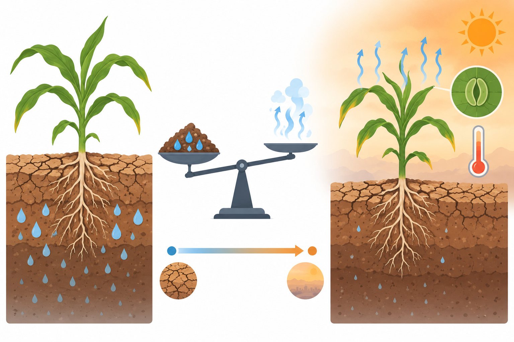

## 原文 / Paper

> Li, L., Fang, Y., Mao, J., Xu, S., Zheng, Z., Li, W., Shi, M., Koven, C. D., Chambers, J., Leung, L. R. & McDowell, N. **Vegetation increasingly controlled by atmospheric dryness rather than soil moisture.** *Nature Geoscience* (2026). https://doi.org/10.1038/s41561-026-02107-w

原文结论：多数地区植被变率由 SM 主导，但过去四十年 VPD 的影响在增强、SM 在减弱，且 SM 主导区向 VPD 控制转移的比例大于反向转移。本仓库从原始数据独立重跑了全流程。

> 原文 PDF 不随仓库分发，请通过 DOI 获取。

## 技术路线 / Workflow

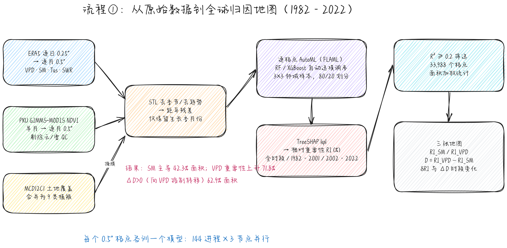

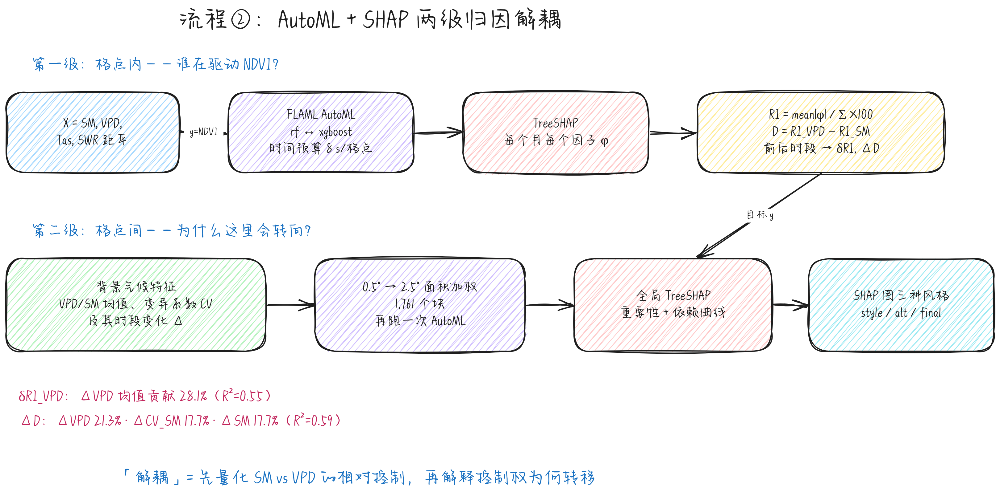

（`.excalidraw` 源文件在 `docs/flowcharts/`，可在 excalidraw.com 直接打开编辑。）

| 步骤 | 脚本 | 内容 |
|---|---|---|
| 1 | `code/01_prep_era5.py` | ERA5 逐日 0.25° → 逐月 0.5° VPD / SM / 气温 / 短波辐射，1982–2022 |
| 2 | `code/02_prep_landcover.py` | MCD12C1 IGBP 2001 → 0.5° 众数，合并为原文 9 类植被 + 网格面积 |
| 3 | `code/03_prep_anomalies.py` | PKU GIMMS-MODIS NDVI 逐月化（剔除云/雪 QC），所有序列 STL 残差、生长季掩膜、均值/CV 指标 |
| 4 | `code/04_worker.py`, `run_node.sh` | 逐格点 FLAML AutoML（rf / xgboost，3×3 邻域样本，80/20），TreeSHAP 计算相对重要性 RI（全时段、1982–2001、2002–2022）及 Welch t 检验 |
| 5 | `code/05_merge_attribution.py` | 合并、R² ≥ 0.2 筛选，生成 RI、D = RI_VPD − RI_SM、δRI、ΔD 场与面积加权统计 |
| 6 | `code/05b_coarsen.py` | 0.5° → 2.5° 面积加权块（1,761 个），作为第二级归因输入 |
| 7 | `code/06_attribution.py` | 第二级：以背景气候特征（均值、CV 及其变化）解释 D / δRI / ΔD 的空间格局（AutoML + TreeSHAP） |
| 8 | `code/shap_plots_encrypted.zip`（加密） | 三种 SHAP 可视化风格（核心代码已加密，需授权获取密码） |

## 运行 / How to run

```bash
pip install -r requirements.txt
python code/01_prep_era5.py
python code/02_prep_landcover.py
python code/03_prep_anomalies.py
# 每节点 48 进程，共 144 rank（3 节点）
bash code/run_node.sh 0   # 48, 96 on other nodes
python code/05_merge_attribution.py proc out data
python code/05b_coarsen.py proc data data25
for t in importance importance_change_SM importance_change_VPD dominance_change; do python code/06_attribution.py data25 $t 600 32; done
unzip code/shap_plots_encrypted.zip -d code  # 需要密码；然后 python code/09_shap_final.py results/shap_final/data results/shap_final
```

脚本内的数据路径（`/data/lhwang/...`）请按需修改。原始 ERA5 / NDVI / MODIS 数据体量大，不包含在仓库中。`results/shap_final/data/` 附带了绘制 SHAP 图所需的散点与统计数据，可直接重绘。

## 主要结果 / Key results

全局 33,988 个有效格点（R² ≥ 0.2），面积加权：

| 指标 | 复现值 |
|---|---|
| 平均 RI_SM / RI_VPD | 26.5% / 27.2% |
| SM 主导面积 | 42.3% |
| VPD 重要性上升面积（δRI_VPD > 0） | 71.8% |
| SM 重要性下降面积（δRI_SM < 0） | 45.3% |
| 向 VPD 控制转移（ΔD > 0） | 62.9% |
| SM 主导 → 更偏 VPD / 更偏 SM | 26.9% / 15.4% |
| VPD 主导 → 更偏 VPD / 更偏 SM | 36.0% / 21.7% |

### 相对重要性 / Relative importance
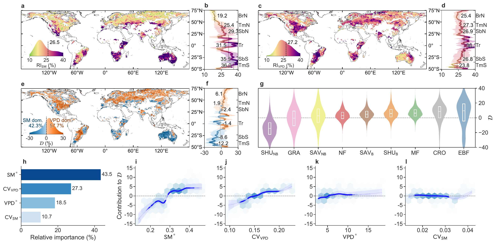

### 相对重要性变化 / Change in relative importance
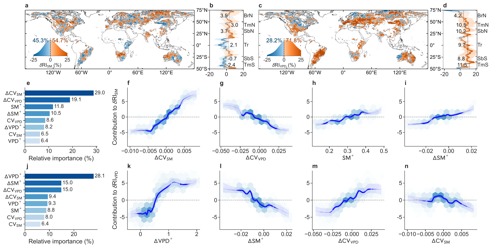

### 主导性变化 / Dominance change
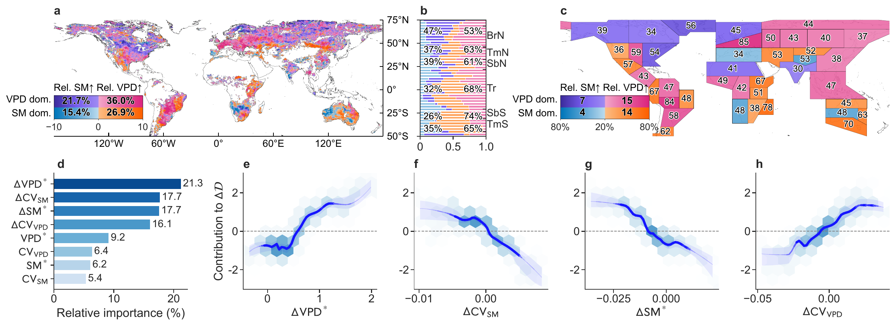

## SHAP 第二级归因 / Second-level SHAP attribution

| 目标 | AutoML 模型 | test R² | 前三位驱动因子（mean \|SHAP\| 占比） |
|---|---|---|---|
| D | XGBoost | 0.23 | SM 均值 43.5%，VPD CV 27.3%，VPD 均值 18.5% |
| δRI_SM | XGBoost | 0.43 | ΔCV_SM 29.0%，ΔCV_VPD 19.1%，SM 均值 11.8% |
| δRI_VPD | XGBoost | 0.55 | ΔVPD 均值 28.1%，ΔSM 均值 15.0%，ΔCV_VPD 15.0% |
| ΔD | XGBoost | 0.59 | ΔVPD 均值 21.3%，ΔCV_SM 17.7%，ΔSM 均值 17.7% |

### 最终版（IPCC AR6 风格） `results/shap_final/`
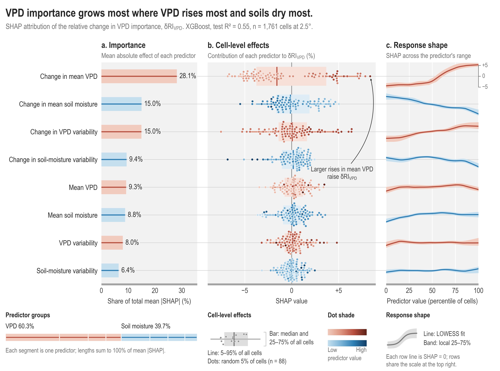
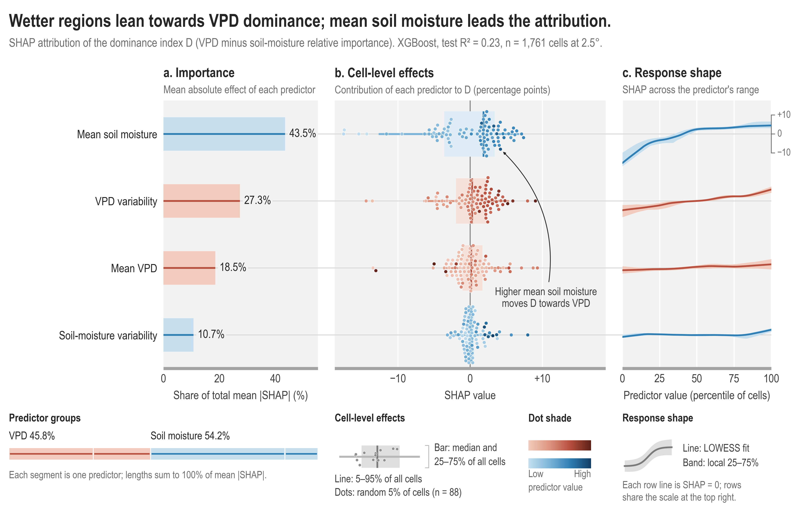
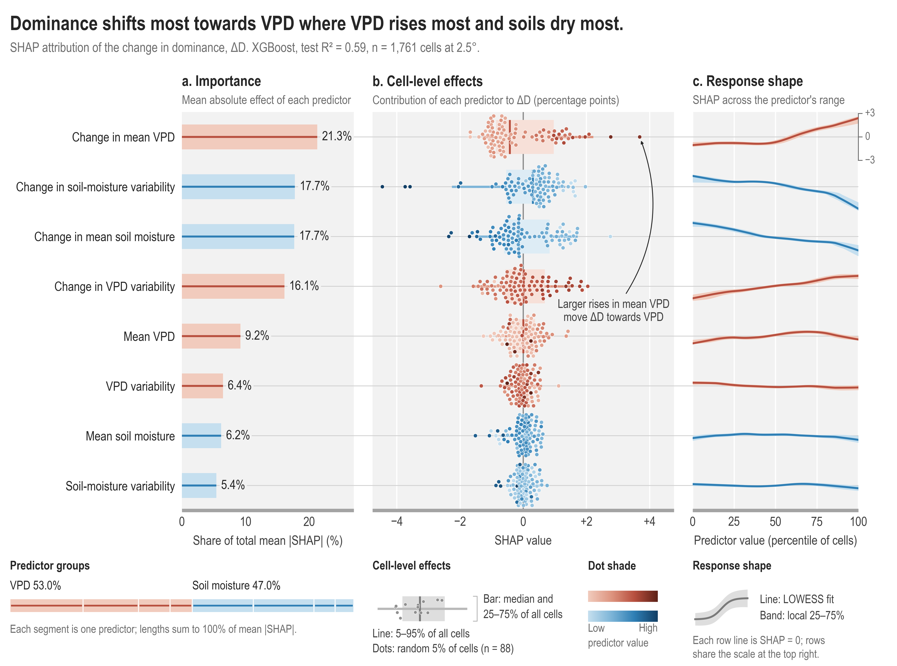
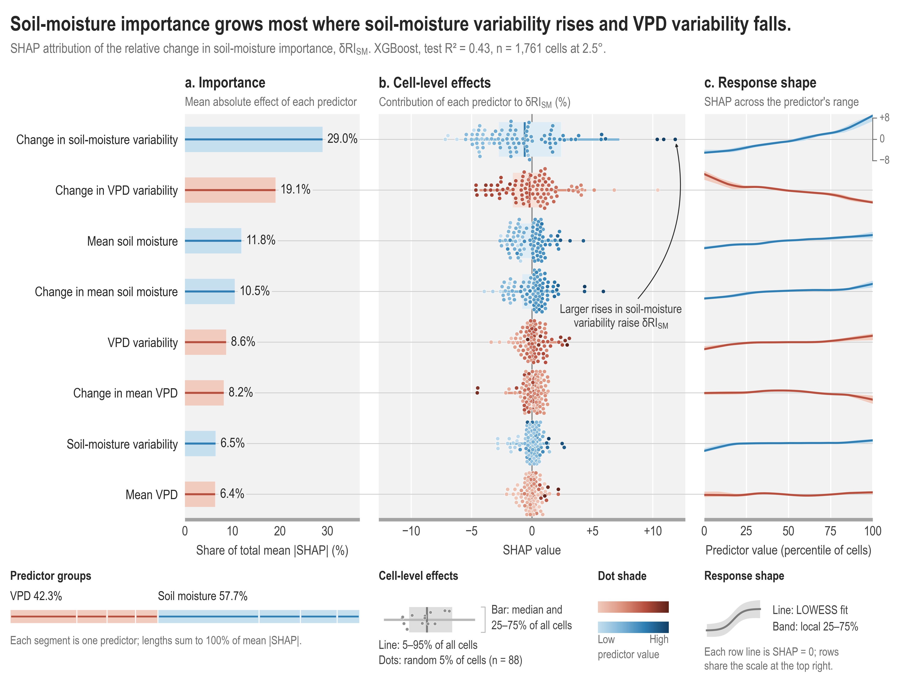

### 风格 A：条形 + 蜂群 + LOWESS `results/shap_style/`
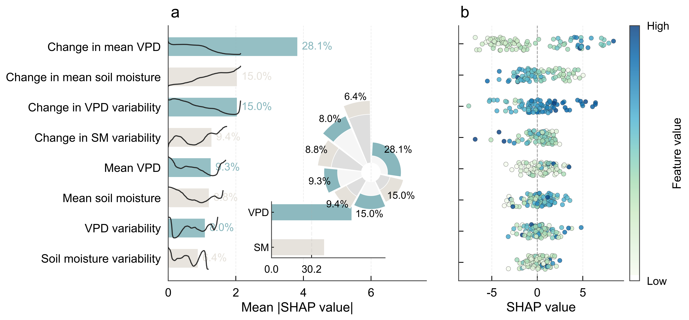

### 风格 B：重要性、抽样蜂群与响应曲线逐行对齐 `results/shap_style_alt/`
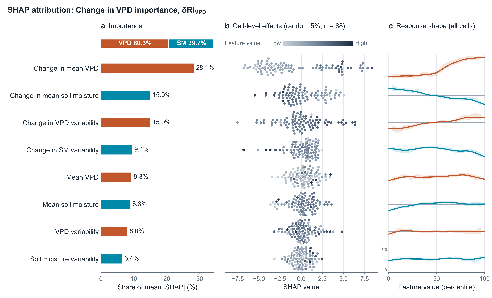

每种风格都有 D / δRI_SM / δRI_VPD / ΔD 四张图，并附 PDF、SVG 矢量版。

## 概念图 / Concepts


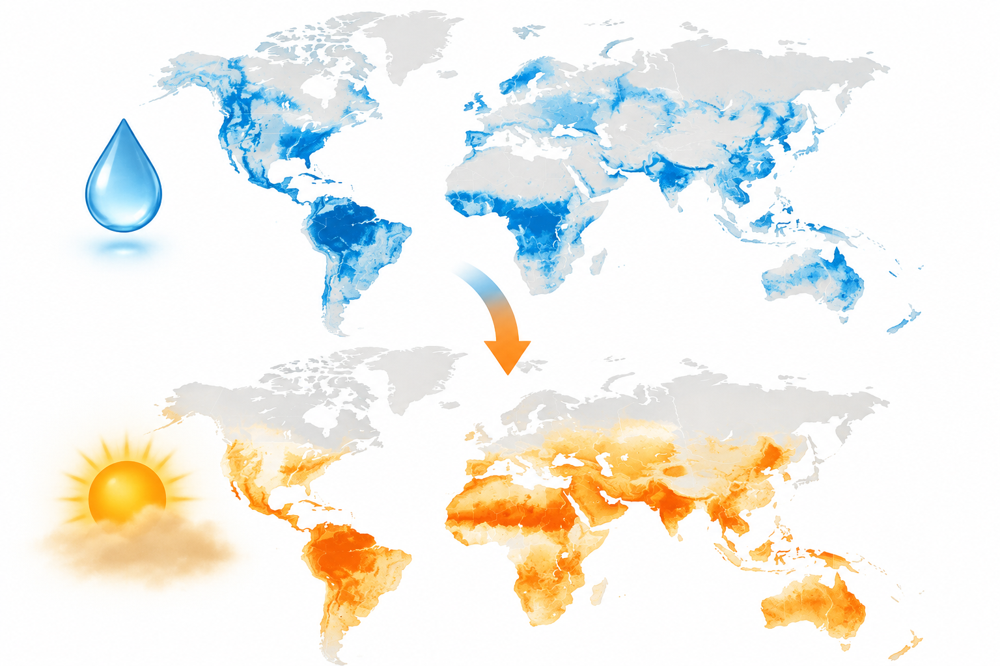

手绘原理图：[`results/concept_diagrams/`](results/concept_diagrams/)

## 说明 / Notes

- 传感器切换诊断：MODIS 时代 NDVI 残差标准差约为 AVHRR 时代的 1.76 倍（中位数），但其对数比与 ΔD 的 Spearman 相关仅 −0.004，ΔD 的格局不是由传感器切换造成的。
- 第二级归因的 D 模型 R² 较低（0.23），解读背景态驱动时应谨慎；变化量模型（R² 0.43–0.59）更稳健。
- 这是独立复现，不是原作者代码。

## 引用 / Citation

如使用本仓库，请引用原文（见上），并注明本复现仓库：https://github.com/GISWLH/vpd-sm-automl-xai
